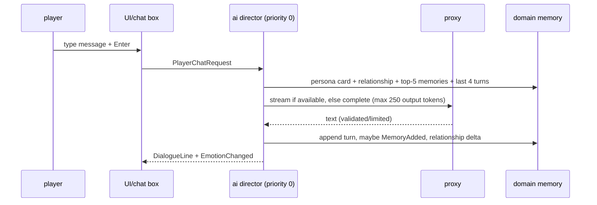
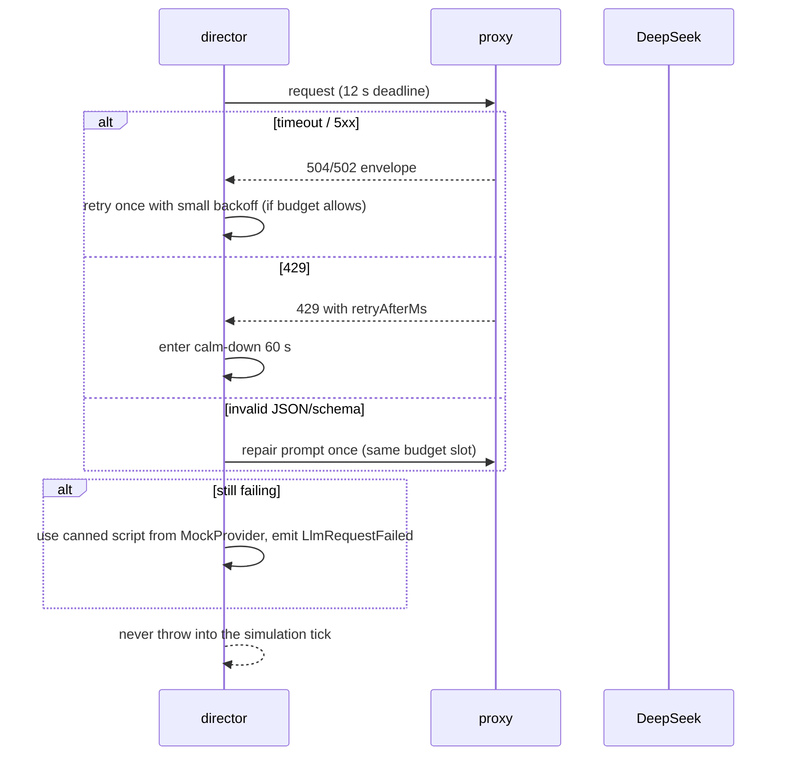

# Architecture — AI Snail World

Status: Phase 1 (walking prototype). This document is the technical source of truth for
structure, boundaries and contracts. Update it in the same change as the code.

## 1. Goals and constraints

- Cozy single-player 2D side-view snail simulation in a modern desktop browser.
- 60 FPS rendering with 10–20 visible snails (design ceiling 30).
- AI agents (future sessions) must be able to make a correct change after reading a few
  small files. Hence small files, `MODULE.md` per module, strict layers, data-driven content.
- Simulation is headless-testable; rendering never owns game truth.
- LLM cost is a scarce resource: tiered cognition, one call per conversation, hard budgets.
- In-game Slovak; code/docs English. UI strings in JSON localization files.
- Destructible bitmap terrain without a physics engine.

**Out of scope forever:** combat, inventory, levelling, quests, multiple modes,
falling-sand physics, embeddings/vector DB, mobile/touch.

## 2. System context

```text
┌──────────────────────────── browser ────────────────────────────┐
│  app (bootstrap, wiring)                                        │
│    ├── presentation (Phaser, UI, audio)  ← snapshots + events   │
│    ├── world (terrain, kinematics, simulation)                  │
│    ├── ai (Tier 1, prompts, providers, budget manager)          │
│    ├── domain (snails, mood, relationships, memory)             │
│    └── core (types, events, config, RNG, math)                  │
│                    │ HTTPS (no key)                             │
└────────────────────┼────────────────────────────────────────────┘
                     ▼
        server/ stateless LLM proxy (Node + Hono)
          rate limit · validation · timeout/retry
                     │ HTTPS + DEEPSEEK_API_KEY
                     ▼
        https://api.deepseek.com/chat/completions
```

## 3. Layers

```text
app ──────────────► presentation ──► world ──► domain ──► core
 │                        │            │          │
 │                        └──────────► ai ────────┘
 └────────────────────────────────────────────────────► (all)
```

Dependency direction is strictly downward. `ai` and `world` are siblings and must not
import each other. `presentation` may read both. `app` may read everything.

## 4. Complete file/folder map

Module folders: `src/core/`, `src/domain/`, `src/ai/`, `src/world/`, `src/presentation/`,
`src/app/`, plus `server/`. Actual files exist now; `(P<n>)` marks planned files for a
later phase. One line each.

```text
.
├─ AGENTS.md                       # entry point for every AI session
├─ ARCHITECTURE.md                 # this blueprint
├─ README.md                       # human quick start
├─ index.html                      # Vite entry, #app root
├─ package.json                    # pinned deps + quality scripts
├─ tsconfig.json / vite.config.ts / vitest.config.ts
├─ eslint.config.js / .dependency-cruiser.cjs / .prettierrc.json
├─ .env.example                    # server secrets template (never commit .env)
├─ assets/
│  ├─ manifest.json                # every asset id/type/path/frame/anchor/status/prompt
│  ├─ manifest.schema.json         # JSON Schema for the manifest
│  └─ PROMPTS.md                   # ready-to-use image generation prompts
├─ docs/
│  ├─ MASTER_PROMPT.md             # origin document (verbatim)
│  ├─ ART_BIBLE.md                 # visual source of truth
│  ├─ AI_DESIGN.md                 # AI tiers, prompts, schemas, personas
│  ├─ TERRAIN.md                   # carving, chunking, collision algorithms
│  ├─ ROADMAP.md                   # phases, acceptance criteria, manual tests
│  ├─ DECISIONS.md                 # lightweight ADR log
│  └─ CHANGELOG_AI.md              # session log
├─ src/
│  ├─ core/                        # foundation, no project deps
│  │  ├─ index.ts                  # public API
│  │  ├─ config.ts                 # tick/world/terrain constants
│  │  ├─ events.ts                 # event catalog + EventBus interface
│  │  ├─ ids.ts                    # branded ids
│  │  ├─ math.ts                   # clamp/lerp/distance helpers
│  │  ├─ rng.ts                    # seeded mulberry32 RNG
│  │  ├─ bus.ts                    # TypedEventBus implementation (P5)
│  │  └─ MODULE.md
│  ├─ domain/                      # pure state and rules
│  │  ├─ index.ts / MODULE.md
│  │  ├─ snail.ts                  # Snail + personality/speech/preferences/appearance
│  │  ├─ mood.ts                   # mood channels + decay
│  │  ├─ relationships.ts          # relationship ranges + clamping
│  │  ├─ memory.ts                 # episodic memory + retrieval score
│  │  ├─ emotion.ts                # canonical emotion/gesture ids
│  │  ├─ data/snails.json          # 6 starter snails (P3)
│  │  ├─ schemas/snail-schema.ts   # zod validation for content data (P3)
│  │  └─ services/                 # mood/relationship/memory updates (P5)
│  ├─ ai/                          # decisions + language contracts
│  │  ├─ index.ts / MODULE.md
│  │  ├─ conversation.ts           # script/outcome/request types
│  │  ├─ conversation-schema.ts    # zod schemas for LLM output
│  │  ├─ llm-provider.ts           # LlmProvider + error types
│  │  ├─ conversation-director.ts  # one-call orchestration (P6)
│  │  ├─ budget-manager.ts         # queue/cooldowns/concurrency (P6)
│  │  ├─ prompt-builders.ts        # pure prompt functions (P6)
│  │  ├─ tier1/social-scoring.ts   # utility AI (P5)
│  │  ├─ tier0/activity-fsm.ts     # movement/routine FSM, injected context (P3)
│  │  ├─ providers/mock-provider.ts
│  │  ├─ providers/deepseek-provider.ts
│  │  └─ data/canned-dialogues.sk.json
│  ├─ world/                       # simulation-side world
│  │  ├─ index.ts / MODULE.md
│  │  ├─ terrain.ts                # mask/query/carver/POI contracts
│  │  ├─ world-state.ts            # snail bodies + snapshot contract
│  │  ├─ terrain-mask.ts           # seeded heightfield mask + queries (carve P2)
│  │  ├─ terrain-carver.ts         # dirty-rect coalescing (P2)
│  │  ├─ collision.ts              # ground/slope/body queries (P2)
│  │  ├─ kinematics.ts             # gravity, walking, step-up (P1)
│  │  ├─ simulation-clock.ts       # fixed-step accumulator + alpha (P1)
│  │  ├─ spatial-hash.ts           # nearby queries (P3)
│  │  ├─ simulation.ts             # fixed-step world simulation (P3)
│  │  └─ data/world-01.json        # world layout + POIs (P3)
│  ├─ presentation/                # Phaser, visuals, UI, audio
│  │  ├─ index.ts / MODULE.md
│  │  ├─ rendering.ts             # snapshot/bubble/icon contracts
│  │  ├─ i18n.ts / i18n/sk.json    # UI strings
│  │  ├─ scenes/boot-scene.ts       # starts the world scene
│  │  ├─ scenes/world-scene.ts      # camera, input, fixed-step drive
│  │  ├─ scenes/ui-scene.ts (P4)
│  │  ├─ sprites/placeholder-snail.ts # procedural Phase 1 snail
│  │  ├─ sprites/snail-rig.ts (P4)
│  │  ├─ terrain-renderer.ts       # mask → chunk canvases/textures
│  │  ├─ terrain-palette.ts        # deterministic pixel colours
│  │  ├─ world-view.ts             # scene ↔ simulation bridge contract
│  │  ├─ fx/crumbs.ts              # cosmetic carve particles (P2)
│  │  ├─ animation/state-machine.ts (P4)
│  │  ├─ data/animations.json / emotions.json (P4)
│  │  ├─ ui/speech-bubble.ts / hud.ts / chat-box.ts (P4/P7)
│  │  ├─ assets/asset-loader.ts    # manifest-driven loading (P4)
│  │  └─ audio/audio-manager.ts (P8)
│  └─ app/                         # wiring only
│     ├─ index.ts / MODULE.md
│     ├─ bootstrap.ts              # builds context + starts Phaser (P1)
│     ├─ main.ts                   # three-line browser entry
│     ├─ game.ts                   # Phaser.Game factory (P1)
│     ├─ wiring.ts                 # simulation + presentation bridge (P1)
│     ├─ persistence/indexed-db.ts # save/load wrapper (P5)
│     └─ persistence/migrations/   # pure version migrations (P5)
├─ server/                         # stateless LLM proxy
│  ├─ index.ts                     # listen
│  ├─ app.ts                       # Hono routes (health now, /api/llm P6)
│  ├─ env.ts                       # parsed env config (P6)
│  ├─ routes/llm.ts (P6)
│  ├─ lib/deepseek.ts (P6)
│  ├─ lib/rate-limit.ts (P6)
│  ├─ lib/errors.ts (P6)
│  └─ MODULE.md
├─ scripts/
│  ├─ docs-check.ts                # structure/doc/dependency gate
│  └─ generate-placeholders.ts (P4)
└─ tests/
   ├─ core/rng.test.ts             # passing now
   ├─ world/terrain.test.ts        # generation + queries (P1)
   ├─ world/kinematics.test.ts     # step-up/fall/landing (P1)
   ├─ world/simulation-clock.test.ts # fixed-step + alpha (P1)
   ├─ domain/… (P5) · ai/… (P5/P6) · world/… (P2/P3) · server/… (P6)
```

## 5. Dependency rules

| From \ To    | core | domain | ai  | world | presentation | app | server |
| ------------ | ---- | ------ | --- | ----- | ------------ | --- | ------ |
| core         | ✓    | ✗      | ✗   | ✗     | ✗            | ✗   | ✗      |
| domain       | ✓    | ✓      | ✗   | ✗     | ✗            | ✗   | ✗      |
| ai           | ✓    | ✓      | ✓   | ✗     | ✗            | ✗   | ✗      |
| world        | ✓    | ✓      | ✗   | ✓     | ✗            | ✗   | ✗      |
| presentation | ✓    | ✓      | ✓   | ✓     | ✓            | ✗   | ✗      |
| app          | ✓    | ✓      | ✓   | ✓     | ✓            | ✓   | ✗      |
| server       | ✗    | ✗      | ✗   | ✗     | ✗            | ✗   | ✓      |

Enforced by `.dependency-cruiser.cjs` AND `npm run docs:check`. Only a module's
`index.ts` may be imported from outside. Phaser is forbidden in core/domain/ai/world.
Node built-ins are forbidden in `src/`. `server/` and `src/` never import each other.

## 6. Runtime topology

- Browser bundle (Vite): all `src/` code. No secrets, no server imports.
- Dev: Vite on `:5173` proxies `/api` to the proxy on `:8787`.
- Proxy: Node + Hono, stateless, can run as a serverless function. Reads
  `DEEPSEEK_API_KEY`, `DEEPSEEK_BASE_URL`, `DEEPSEEK_MODEL`, `RATE_LIMIT_PER_MINUTE`,
  `LLM_TIMEOUT_MS`, `ALLOWED_ORIGIN`.
- Verified DeepSeek contract (2026-11): `POST https://api.deepseek.com/chat/completions`,
  OpenAI-compatible, models `deepseek-flash` (default) and `deepseek-v4-pro`,
  `response_format: { type: "json_object" }`, `thinking: { type: "disabled" }` for cheap
  structured NPC calls. Thinking mode is ON by default when omitted. See ADR-006.

## 7. Simulation loop and timing

Phaser's RAF loop feeds `SimulationClock`, which accumulates real time and executes fixed
ticks. Rendering receives `alpha = accumulator / FIXED_DELTA_SECONDS`.

Phase 1 implements only the player slice: `app/wiring.ts` owns the player
`KinematicState` and steps `world/kinematics.ts`; `presentation/scenes/world-scene.ts`
owns the clock, samples keyboard intents, interpolates the sprite and drives the camera.
Later phases add the world simulation, AI and event bus around the same clock.

| Work                    | Frequency                | Notes                                              |
| ----------------------- | ------------------------ | -------------------------------------------------- |
| Input sampling          | every frame              | keyboard/mouse, writes intents only                |
| Simulation tick         | 30 Hz fixed              | `FIXED_DELTA_SECONDS = 1/30`, max 5 catch-up ticks |
| Tier 0 movement/FSM     | every tick               | steering, gravity, terrain collision               |
| Mood decay              | every tick               | cheap scalar math                                  |
| Spatial hash rebuild    | every tick               | 30 snails is trivial                               |
| Tier 1 social scoring   | 5 Hz, staggered          | 1/6 of snails per tick, no LLM                     |
| Encounter detection     | 5 Hz                     | distance + relationship + cooldown                 |
| Off-screen snail update | 5 Hz                     | simplified steering; no LLM                        |
| Conversation playback   | 10 Hz timer              | line durations, interrupt checks                   |
| Async LLM apply         | next tick after response | queued outcomes, never block a tick                |
| Render                  | display rate (60 FPS)    | interpolate positions, read snapshot               |
| Save                    | every 60 s + `pagehide`  | IndexedDB, versioned                               |

Tick order (deterministic):

1. Drain queued input intents.
2. Apply completed LLM outcomes (relationships, mood, memory).
3. Decay mood toward baseline.
4. Tier 0 update (activity FSM → steering → kinematics → terrain resolve).
5. Rebuild spatial hash.
6. Tier 1 social decisions for the staggered subset; enqueue conversations.
7. Advance active conversation playback; handle interruptions.
8. Emit collected events; publish immutable `WorldSnapshot`.
9. Increment tick.

## 8. Data models

Actual contracts live in `src/domain`, `src/ai`, `src/world`, `src/core`. Key shapes:

```ts
interface Snail {
  id: SnailId;
  identity: { name: string; backstory: string };
  personality: Personality;              // Big Five, each 0..1
  quirks: readonly string[];             // 2-3 short notes
  speechStyle: SpeechStyle;              // vocabulary, length, catchphrases, neverSays
  preferences: Preferences;              // places/topics/snails liked & disliked
  appearance: Appearance;                // palettes, shell pattern, accessory, sizeScale
  mood: Mood;                            // valence -1..1, arousal 0..1, energy 0..1
  moodBaseline: MoodBaseline;
  relationships: Record<string, Relationship>;
  memory: readonly MemoryEntry[];
}

interface Personality { openness: number; conscientiousness: number; extraversion: number;
                       agreeableness: number; neuroticism: number } // each 0..1
interface Mood { valence: number; arousal: number; energy: number } // -1..1 / 0..1 / 0..1
interface MoodBaseline { valence: number; arousal: number; energy: number }
interface Relationship { affinity: -100..100; trust: -100..100; familiarity: 0..100;
                         tags: readonly string[]; lastInteractionTick: number }

interface MemoryEntry { id; tick; timestampMs; participants; locationTag;
                        text; emotion; importance: 1..10; keywords }

interface ConversationScript { conversationId; participantIds: [SnailId, SnailId];
                               lines: DialogueLine[]; outcome: ConversationOutcome }
interface DialogueLine { speaker: 'a'|'b'; text: string; emotion: EmotionId;
                         gesture?: GestureId }
interface ConversationOutcome {
  relationshipDeltas: Record<'a'|'b', { affinity: -10..10; trust: -10..10;
                                        familiarity: 0..5 }>;
  moodDeltas: Record<'a'|'b', { valence; arousal; energy }>;
  memoryEntries: { speaker: 'a'|'b'; text: string; importance: 1..10 }[];
  followUpIntent: string | null;
}
```

Presentation catalogs (data files, validated at load):

```ts
interface EmotionDef {
  id: EmotionId;
  faceVariants: readonly string[]; // e.g. ["joy_a", "joy_b"]
  gestureVariants: readonly GestureId[];
  icon: string; // asset id from assets/manifest.json
}
interface AnimationDef {
  id: string; // e.g. "crawl"
  layer: 'body' | 'shell' | 'face' | 'accessory';
  frames: number;
  fps: number;
  loop: boolean;
  anchor: { x: number; y: number }; // normalised pivot, bottom center = {0.5, 1}
  allowedTransitions: readonly string[];
}
```

All JSON content is validated with zod before use. Invalid content fails fast in dev and
falls back to safe defaults in production (unknown emotion/gesture → `neutral`).

## 9. Event catalog

Events are defined only in `src/core/events.ts`. Payloads are plain data.

| Event                 | Payload                                            | Emitter                   | Consumers                                 |
| --------------------- | -------------------------------------------------- | ------------------------- | ----------------------------------------- |
| `Tick`                | tick, deltaSeconds                                 | app clock                 | world, ai, presentation                   |
| `SnailMet`            | aId, bId, tick, distance                           | world encounter detection | ai, presentation, save                    |
| `ConversationStarted` | conversationId, participantIds, tick               | ai director               | presentation, save                        |
| `DialogueLine`        | conversationId, speakerId, text, emotion, gesture? | ai director / playback    | presentation (bubble + animation)         |
| `ConversationEnded`   | conversationId, participantIds, reason, tick       | ai director               | presentation, ai, save                    |
| `EmotionChanged`      | snailId, emotion, intensity                        | domain/ai                 | presentation                              |
| `MoodChanged`         | snailId, valence, arousal, energy                  | domain/ai                 | presentation, save                        |
| `RelationshipChanged` | fromId, toId, affinity, trust, familiarity         | domain/ai                 | presentation, save                        |
| `MemoryAdded`         | snailId, memoryId, importance                      | domain/ai                 | save, debug log                           |
| `TerrainCarved`       | x, y, radius, dirty rect                           | world carver              | presentation (redraw), ai (flee)          |
| `LlmRequestFailed`    | requestId, reason, willFallback                    | ai director               | presentation (thinking icon), diagnostics |

## 10. AI tier model

- **Tier 0 — movement/routine, no AI:** FSM/steering every tick. States: wander,
  walk-to-POI, rest, sleep, look-around, approach-snail, flee-hole, fall/land, munch.
- **Tier 1 — social decision, local:** utility scoring (few times/second) decides whether
  to greet/ignore/avoid/join, with whom. Inputs: personality, mood, relationship, distance,
  cooldowns, conversation slots, novelty.
- **Tier 2 — LLM, rare:** whole NPC↔NPC conversation + outcome (one call), memory
  compaction/reflection, player chat. Never per-line calls.

Details, formulas and token budgets: `docs/AI_DESIGN.md`.

## 11. Request budget manager (defaults)

| Parameter                        | Default                                                                                             |
| -------------------------------- | --------------------------------------------------------------------------------------------------- |
| Max concurrent requests          | 2                                                                                                   |
| Max requests per minute (global) | 8                                                                                                   |
| Player-chat reserve              | 2 slots/min always available                                                                        |
| Per-snail cooldown               | 90 s                                                                                                |
| Per-pair cooldown                | 180 s                                                                                               |
| Cache TTL                        | 10 min, key = hash(sorted pair, reason, location, mood bucket, relationship bucket, top memory ids) |
| Request timeout                  | 12 s (proxy and client)                                                                             |
| Repair attempts                  | 1 (schema-failure retry)                                                                            |
| Calm-down trigger                | queue > 6 or HTTP 429 → no new NPC calls for 60 s                                                   |
| Off-screen pairs                 | no LLM; rule-based abstract encounters only                                                         |

Priority queue order: player chat > player-observed conversation > visible NPC pair >
reflection/compaction. Over budget → canned/Mock dialogue, `LlmRequestFailed` with
`willFallback: true`, game continues.

## 12. Sequence: NPC meets NPC → conversation → outcome → memory

```mermaid
sequenceDiagram
  participant W as world/simulation
  participant A as ai director + budget
  participant P as proxy
  participant D as DeepSeek
  participant R as domain state
  participant V as presentation

  W->>W: spatial hash detects nearby pair
  W-->>A: SnailMet
  A->>A: Tier-1 score, cooldown, slots, cache
  alt cache hit or budget denied
    A->>R: apply canned outcome
    A-->>V: ConversationStarted + lines
  else call allowed
    A-->>V: ConversationStarted (thinking icon)
    A->>P: POST /api/llm/complete (one prompt)
    P->>D: /chat/completions (json_object, thinking disabled)
    D-->>P: JSON script + outcome
    P-->>A: validated envelope
    A->>A: zod validate; repair once; fallback if invalid
    A->>R: apply deltas, mood, memory
    A-->>V: DialogueLine events, then ConversationEnded
  end
```

Playback is interruptible: player walks in, terrain collapse, or save load ends the
conversation politely with reason `interrupted`; already-generated outcome is still applied.

## 13. Sequence: player chat



Player chat context is bounded (never full history). Failure shows a Slovak fallback line
and does not block input.

## 14. Sequence: terrain carve → collision/visual update

```mermaid
sequenceDiagram
  participant I as input (munch)
  participant T as TerrainMask/Carver
  participant C as collision queries
  participant V as presentation
  participant A as ai

  I->>T: carveCircle(x, y, r)
  T->>T: clamp bbox, clear pixels in circle, mark chunks dirty
  T-->>V: TerrainCarved { dirty rect }
  V->>V: redraw dirty chunks (soil, grass cap, inner edge)
  C->>C: bodies re-sample ground; unsupported bodies start falling
  T-->>A: TerrainCarved → flee-hole / look-at-hole behavior
```

Mask mutation happens before the event is emitted; rendering never mutates terrain.

## 15. Sequence: LLM failure / fallback ladder



## 16. Persistence / save format

IndexedDB database `ai-snail-world`, object store `saves`, key `current`. Versioned:

```ts
interface SaveGameV1 {
  schemaVersion: 1;
  savedAt: string; // ISO timestamp
  world: {
    seed: string;
    tick: number;
    playerSnailId: SnailId;
    terrainRleBase64: string; // RLE of the Uint8Array mask
    terrainWidth: number;
    terrainHeight: number;
  };
  snails: SnailSaveV1[]; // identity ref, mood, relationships, memory, position
  settings: { locale: 'sk'; volume: number };
}

type SnailSaveV1 = {
  id: SnailId;
  x: number;
  y: number;
  mood: Mood;
  relationships: Record<string, Relationship>;
  memory: MemoryEntry[];
};
```

- Save on a 60 s interval and on `pagehide`; never on every tick.
- Load: parse → migrate by `schemaVersion` → zod validate → fallback to a new world if
  corrupt. Migrations live in `src/app/persistence/migrations/` and are pure functions.
- Terrain is RLE-compressed because the raw mask is ~3.84 MB for 3200×1200.

## 17. Error handling strategy

| Failure              | Behaviour                                                       |
| -------------------- | --------------------------------------------------------------- |
| LLM timeout/5xx      | one retry with backoff, then canned dialogue                    |
| LLM 429              | calm-down mode, no NPC calls for 60 s, player chat still served |
| Invalid JSON/schema  | one repair call, then canned dialogue                           |
| Offline/no proxy     | `MockProvider`, game remains fully playable                     |
| Corrupt save         | log, start new world, never crash the shell                     |
| Invalid content JSON | fail fast in dev; safe defaults in production                   |
| Carve outside world  | clamp to bounds; empty carve returns `null`                     |
| Frame overrun        | drop catch-up ticks above 5; simulation slows, never spirals    |

Errors never escape an async LLM task. The simulation loop has no `await`.

## 18. Performance budgets (desktop, 60 FPS)

| Budget                         | Target                               |
| ------------------------------ | ------------------------------------ |
| Frame total                    | ≤ 16.7 ms                            |
| Simulation tick (30 Hz)        | ≤ 4 ms                               |
| Tier 1 scoring pass            | ≤ 0.5 ms                             |
| Render CPU                     | ≤ 8 ms                               |
| Single `carveCircle(r=24)`     | ≤ 2 ms                               |
| Terrain dirty redraw           | only dirty chunks, ≤ 4 ms            |
| Memory retrieval (top-5 of 40) | ≤ 0.2 ms                             |
| Visible snails                 | 10–20 comfortable, 30 design ceiling |
| LLM concurrent                 | 2, async only                        |

No per-frame allocations in hot paths; reuse vectors and arrays. Measure before optimizing.

## 19. Security

- `DEEPSEEK_API_KEY` only in server `.env`; never `VITE_*`, never in git, never logged.
- Proxy validates body with zod: max messages, max characters, allowed fields.
- CORS allowlist from `ALLOWED_ORIGIN`; rate limit per session/IP hash.
- No user auth in v1 (local game); the proxy is not a general-purpose open endpoint.
- LLM output is untrusted: schema validation, length limits, rendered as text (never HTML).
- Dependencies are pinned exactly; new dependencies require an ADR.

## 20. Quality gates

`npm run build` (typecheck + Vite), `npm test` (Vitest), `npm run lint` (ESLint +
dependency-cruiser), `npm run docs:check` (module docs, line limits, file map, deps).
CI (later) runs exactly these four commands. A change is incomplete if any gate fails.
